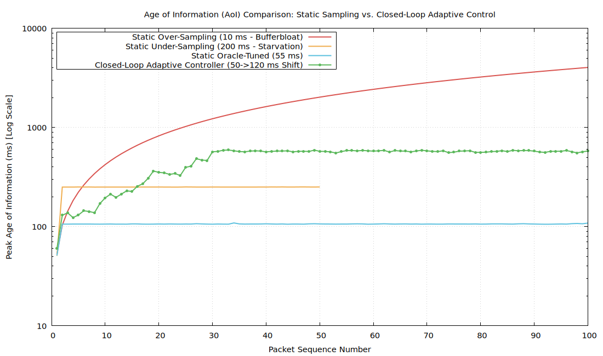
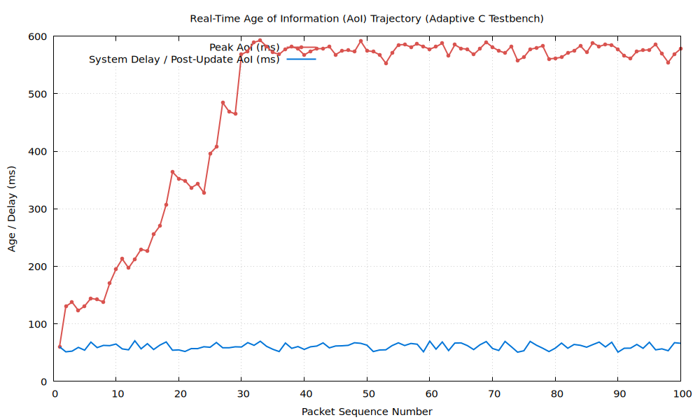

# Real-Time Status Update & Age of Information (AoI) Optimization Testbench

A Linux C/TCP socket testbench designed to measure, analyze, and optimize **Age of Information (AoI)** in real-time status update systems. This project demonstrates the fundamental conflict between TCP throughput/FIFO reliability and information freshness, implementing a closed-loop adaptive sampling controller with native C/Linux visualization.

---

## 1. Theoretical Background

In real-time communication and signal processing systems (e.g., remote telemetry, radar tracking, networked control), **Age of Information ($\text{AoI}$)** quantifies the freshness of knowledge a monitor has about a remote physical process:

$$\Delta(t) = t - U(t)$$

where $t$ is the current time and $U(t)$ is the generation timestamp of the most recently received status update.

### The AoI U-Curve Trade-Off
Standard TCP sockets guarantee in-order byte delivery (FIFO) without considering packet staleness, creating two failure regimes:
* **Over-Sampling ($\lambda > \mu$):** Generating updates faster than the receiver/link service rate causes packets to queue inside OS TCP buffers (*bufferbloat*). Even though packets arrive continuously, each packet is already stale when processed, driving Peak AoI upward.
* **Under-Sampling ($\lambda \ll \mu$):** Generating updates too slowly leaves the link idle, causing $\Delta(t)$ to grow linearly between infrequent arrivals (*information starvation*).
* **Closed-Loop Adaptive Control:** By feeding back measured system delay ($D_k$) from the receiver to the transmitter and tracking baseline service delay via a BBR-style sliding window minimum ($D_{\min}$), the transmitter dynamically adjusts its sampling interval $T_s$ via AIMD (Additive-Increase / Multiplicative-Decrease) to eliminate queueing delay without manual rate tuning.

---

## 2. System Architecture & Features

* **Bidirectional TCP Socket Framework (`AF_INET`, `SOCK_STREAM`):** Custom packed binary protocol frames (`__attribute__((packed))`) with an exact-byte stream reader (`read_exact()`) to prevent TCP partial-read corruption.
* **Nanosecond Monotonic Timestamping:** Uses `clock_gettime(CLOCK_MONOTONIC, ...)` to eliminate wall-clock drift across processes.
* **Closed-Loop Adaptive Rate Controller:** Tracks a 10-packet sliding window minimum delay to distinguish genuine network queueing delay from permanent shifts in link service time.
* **Native C/Linux Visualization:**
  * **Live Terminal Dashboard:** Real-time color-coded ASCII bar graph rendered via ANSI escape sequences.
  * **Automated Plotting:** Spawns `gnuplot` directly from C using POSIX `popen()` pipes to export high-resolution PNG charts.
* **Kernel Network Impairment Testing:** Validated under real packet delay and jitter using Linux Traffic Control (`tc qdisc netem`).

---

## 3. Experimental Results (Linux / WSL Testbench)

### Phase 1: Static Sampling Baseline (50 ms Receiver Service Bottleneck)
| Sampling Regime | Sampling Interval ($T_s$) | Average Peak AoI | Average Post-Update AoI (System Delay) | Observation |
| :--- | :---: | :---: | :---: | :--- |
| **Over-Sampling** | `10 ms` | **2048.98 ms** | **2038.73 ms** | Severe TCP FIFO bufferbloat |
| **Optimal Rate** | `55 ms` | **105.82 ms** | **50.76 ms** | Near-zero queueing delay |
| **Under-Sampling** | `200 ms` | **246.92 ms** | **50.53 ms** | High AoI due to update starvation |

### Phase 2 & 3: Closed-Loop Adaptive Controller (Starting Blind at 10 ms)
| Test Scenario | Average Peak AoI | Average Post-Update AoI | Performance vs. Static 10 ms |
| :--- | :---: | :---: | :---: |
| **Constant 50 ms Bottleneck** | **101.32 ms** | **50.68 ms** | **95.05% reduction** in Peak AoI |
| **Dynamic Shift (`50 ms -> 120 ms` at Packet 50)** | **304.98 ms** | **85.66 ms** | Adapts automatically to shifting bottleneck |

---

## 4. Visualizations

### Multi-Regime Comparison (Static Sampling vs. Closed-Loop Adaptive Control)


### Dynamic Link Shift Adaptation (`50 ms` to `120 ms` Mid-Stream)


---

## 5. Repository Structure

```text
├── receiver.c               # Phase 1: Baseline TCP FIFO server & AoI CSV logger
├── transmitter.c            # Phase 1: Fixed-rate status update generator
├── adaptive_receiver.c      # Phase 2: Bidirectional receiver returning delay feedback ACKs
├── adaptive_transmitter.c   # Phase 2: Windowed BBR-style AIMD adaptive rate controller
├── visual_receiver.c        # Phase 3: Live ASCII terminal visualizer + gnuplot pipe exporter
├── plot_comparison.c        # Phase 4: Multi-curve benchmark plot generator via gnuplot
├── aoi_final_comparison.png # Benchmark comparison plot (Log-scale Peak AoI)
├── aoi_live_run.png         # Real-time adaptive trajectory plot
└── *.csv                    # Logged experimental datasets
```

---

## 6. How to Build & Run (Linux / WSL)

### Prerequisites
```bash
sudo apt update && sudo apt install build-essential gnuplot -y
```

### Compilation
```bash
gcc receiver.c -o receiver -O2
gcc transmitter.c -o transmitter -lm -O2
gcc adaptive_receiver.c -o adaptive_receiver -O2
gcc adaptive_transmitter.c -o adaptive_transmitter -lm -O2
gcc visual_receiver.c -o visual_receiver -O2
gcc plot_comparison.c -o plot_comparison -O2
```

### Running the Adaptive Visual Testbench
Open two terminal tabs in the project directory:

* **Terminal 1 (Receiver with `50 ms` initial service delay shifting to `120 ms` at packet 50):**
  ```bash
  ./visual_receiver 50 120
  ```
* **Terminal 2 (Transmitter starting blind at `10 ms` interval for `100` packets):**
  ```bash
  ./adaptive_transmitter 10 100
  ```
